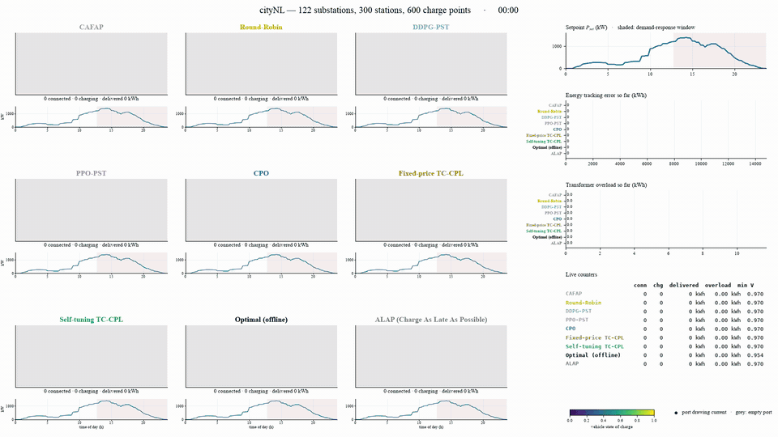

# TC-CPL — Transformer-Constrained Charging Policy Learning

<p align="center">
  
  <br>
  <em>One simulated day on the cityNL scenario (122 substations, 300 stations,
  600 charge points): nine charging controllers, TC-CPL among them, follow the
  same power setpoint side by side.</em>
  <br>
  <a href="https://github.com/danialsj77/TC-CPL/raw/main/figs/policy_simulation.mp4">Download the full-quality video (MP4, 9 MB)</a>
</p>

Code, data and results for the manuscript **"Power Setpoint Tracking for Large-Scale EV
Charging: Transformer-Constrained Charging Policy Learning with Self-Tuning
Constraint Prices"**, submitted to *IEEE Transactions on Transportation
Electrification*. Built on the [EV2Gym](https://github.com/StavrosOrf/EV2Gym)
simulator.

**Authors:** Daniyal Sajedi-Hosseini, Yoshihiko Fujisawa, Shubham Singh, Lei
Zhou, Katsuki Fujisawa, Sebastien Gros, Mazaher Karimi, and Xun Shen.

**Affiliations:** Daniyal Sajedi-Hosseini and Xun Shen, Tokyo University of
Agriculture and Technology; Yoshihiko Fujisawa, Shubham Singh, Lei Zhou and
Katsuki Fujisawa, Institute of Science Tokyo; Sebastien Gros, Norwegian
University of Science and Technology; Mazaher Karimi, University of Vaasa.

---

## Start here

| You want to | Read |
|---|---|
| run the code on your own computer: a laptop, a workstation or one GPU, under Windows, macOS or Linux | **[GETTING_STARTED.md](GETTING_STARTED.md)** — install, a 2-minute smoke test, training, evaluation, what every result file means, problems and fixes |
| look at the results of the paper without running anything | [`results/cityNL/`](results/cityNL), [`results/PublicPST_S/`](results/PublicPST_S) and [`revision/runs/`](revision/runs); the files are explained in [GETTING_STARTED.md, Section 7](GETTING_STARTED.md#7-what-the-result-files-mean) |
| reproduce every number of the paper: the 116 training jobs, on several servers or a cluster | [Reproducing the paper](#reproducing-the-paper-the-116-job-campaign) below, and the command-by-command page [RUN_ON_SUPERCOMPUTER.md](RUN_ON_SUPERCOMPUTER.md) |
| change a setting or find a file | [Settings](#settings) and [Files](#files) below |

### Quick start

Python 3.10 or 3.11 (not 3.12), about 10 GB of disk, a GPU is optional.

```bash
git clone https://github.com/danialsj77/TC-CPL.git
cd TC-CPL
python3.11 -m venv .venv && source .venv/bin/activate      # Windows: py -3.11 -m venv .venv  then  .venv\Scripts\activate
pip install -r requirements.txt
python tccpl_learner.py                                    # must print "self-test OK" twice
python train_one.py --algo tccpl --seed 1 --scenario PublicPST_S --timesteps 300 --offline-transitions 100    # 300-step smoke test, seconds
```

A real training run is the same command without the last two options and with a seed of the
protocol (`python train_one.py --algo tccpl --seed 42 --scenario PublicPST_S`; hours), and evaluation
is Section 7 of `TC-CPL.ipynb`. Every step, with the time it takes and what it writes, is in
[GETTING_STARTED.md](GETTING_STARTED.md).

## What is here

**The problem.** Many charge points share a few transformers. Every 15 minutes a controller
sets the power of each charge point so that the site follows a power setpoint from the grid
operator, drivers get the energy they asked for, and no transformer is overloaded.

**The method.** TC-CPL learns such a controller by reinforcement learning with three
mechanisms: M1, constraint prices that tune themselves during training instead of being
hand-set per site; M2, a warm start from an incumbent controller (Round-Robin) and a residual
action anchored to it; M3, a structured encoder that pools charge points per transformer, so
one network serves sites of any size.

**Controllers compared.** Self-tuning TC-CPL, Fixed-price TC-CPL (the same learner with frozen
prices, the ablation), DDPG-PST, PPO-PST, CPO, the CAFAP and Round-Robin heuristics, and the
offline optimum with perfect foresight.

**The two scenarios** (`ev2gym/example_config_files/`):

- **PublicPST-S** (`PublicPST_S`) — 20 charge points behind one 42-kW transformer with
  household load, PV and demand-response events drawn per day, 96 intervals of 15 minutes.
  Fast: the small-scale study. It replaces the **PublicPST** scenario of the first submission
  (20 charge points, 100-kW transformer, no grid simulation), whose transformer never binds;
  `PublicPST` still runs.
- **cityNL** — a Dutch city feeder: 122 substations, 300 stations (600 charge points), full AC
  power flow. About ten times slower. The main result of the paper.

**The results of the paper**, ready to read:

| Folder | What |
|---|---|
| `results/cityNL/`, `results/PublicPST_S/` | evaluation of all five learners (five seeds each) and the heuristics on the same 100 days: tables as CSV and JSON, price histories, significance tests, figures (the full figure set, including the design panels of both scenarios, is in `results/cityNL/`) |
| `revision/runs/PublicPST_stress/` | the 66 variant runs on PublicPST-S (ablations and sensitivity): training record and evaluation of each |
| `revision/runs/floor/`, `revision/runs/offline_v2/` | attainable-overload floors of the incumbents and the hindsight study |

The trained checkpoints (50 models, 440 MB) are not in the repository; the training and
evaluation they went through is fully scripted below.

## Reproducing the paper: the 116-job campaign

> Command by command, with the output of each step:
> [`RUN_ON_SUPERCOMPUTER.md`](RUN_ON_SUPERCOMPUTER.md).

### Step 1 — Install

The Quick start above, in a **fresh clone in a new folder**; `python tccpl_learner.py` must
print `self-test OK`.

### Step 2 — Run the 116 jobs

The campaign is **116 independent jobs**:

| Jobs | What one job does | Needs | Time per job (campaign servers) |
|---|---|---|---|
| 50 main jobs: 5 algorithms × 5 seeds on cityNL and on PublicPST-S | trains one controller for 1,000,000 steps (`train_one.py`) | 1 GPU, about 8 GB RAM (DDPG 18 GB) | cityNL TC-CPL 12–30 h, other cityNL 4.5–9 h, PublicPST-S TC-CPL 10–21 h, rest under 4 h |
| 66 PublicPST-S variant jobs (`revision/stress_tasks.txt`) | trains one variant for 200,000 steps and evaluates it | CPU only, about 3 GB RAM | 1.5–12 h |

**Choose ONE way to run the jobs.** A, B and C below are three alternative ways to run
the *same* 116 jobs with the same settings and produce the same result files; they differ
only in the computers used. Pick the one that matches your computers, follow only that part, and skip the other two:

| Your computers | Use |
|---|---|
| several separate servers, each with its own disk (how the campaign was run) | **A** (about 1.5 days with 7 servers) |
| a cluster where jobs are submitted to a scheduler (`qsub` or `sbatch`) and every node sees the same folder, e.g. TSUBAME | **B** (about 1.5 days if all jobs start at once; the longest job takes 30 h) |
| one machine | **C** (about 11 days at 4 jobs at a time) |

The 116 jobs sum to about 1,100 job-hours. Do not combine the three ways: running B as well as
A would train every job twice. Whichever you choose, use a **fresh clone in a new folder**
(Step 1), and if a job fails or a machine restarts, **run the same command again**: finished
jobs are skipped and only the missing ones run. (The records of the variant runs come with the
clone, but without their models, so they are trained again.)

#### A — Several servers without a shared disk

The step-by-step page [`RUN_ON_SUPERCOMPUTER.md`](RUN_ON_SUPERCOMPUTER.md) gives every command.
In short, with 7 servers:

1. On every server: Step 1 (fresh clone and install).
2. On server K (K = 1 … 7), the same command with only K changed:
   `nohup python run_sweep.py --part K/7 --jobs 5 > sweep_partK.log 2>&1 &`.
   The 7 servers then run different shares that together cover all 116 jobs exactly once.
3. When a server has finished: `python run_sweep.py --part K/7 --pack partK.tgz`. This packs
   only the files that server produced. (Do not tar whole folders: a fresh clone also holds
   earlier copies of some results, which would overwrite another server's new results.)
4. Unpack all `partK.tgz` into one fresh clone and go to Step 3.

`--jobs 5` = five jobs at the same time on each server (not the total number of jobs); it
needs about 64 GB of RAM and 20 or more cores per server. On smaller servers use `--jobs 2`
(about 3.5 days with 7 servers). A server with several GPUs: add `--gpus 0,1,2,3`.
`python run_sweep.py --plan 7 --jobs 5` prints each server's share and the hours.

#### B — A cluster with a scheduler and a shared disk

Two array jobs, submitted once, from the repository folder; the scheduler starts every job
as soon as a node is free, each with its own GPU or CPU cores:

```bash
mkdir -p logs/qsub                                     # Grid Engine (TSUBAME): the log folder must exist first
qsub -g <your-group> tsubame_sweep.sh                  # the 50 main jobs (GPU)
qsub -g <your-group> revision/stress_sweep.sh          # the 66 PublicPST-S variant jobs (CPU)
```

On a SLURM cluster instead: `mkdir -p logs/slurm`, then `sbatch slurm_sweep.sh` and
`sbatch revision/stress_sweep.sh`.

`-g <your-group>` names the TSUBAME group whose budget pays (`t4-user-info group list`);
without it a job runs in trial mode, limited to 10 minutes. Before submitting, open both
scripts once: check the resource type (`gpu_1`, `cpu_8`) and the time limit (48 h in
`tsubame_sweep.sh`, 96 h in `slurm_sweep.sh`, 16 h for the variant jobs; a job cannot be
paused, so do not go below one full job), and uncomment the line that activates `.venv` (the
scheduler does not inherit your shell's environment). To see what a task runs without running
it: `TCCPL_DRY=1 SGE_TASK_ID=7 bash tsubame_sweep.sh`.
When all tasks have finished, go to Step 3 in the same folder.

#### C — One machine

```bash
nohup python run_sweep.py --jobs 4 > sweep.log 2>&1 &
```

runs all 116 jobs, 4 at a time (about 11 days; `--jobs 8` about 6 days if the machine has
about 100 GB of RAM). `python run_sweep.py --dry-run` shows what is finished. Then Step 3.

### Step 3 — Check and pack the results

In the folder that holds all results (A: the merged clone; B: the cluster folder; C: the machine's folder):

```bash
python check_cluster_results.py        # ok / FAIL for each of the 116 jobs; exit code 0 = complete
python run_sweep.py --pack tccpl_results.tgz
```

The archive (about 1 GB) holds every checkpoint, training record and evaluation the campaign
produced. Pack it only when the check passes; if it lists failures, run the missing jobs first.
(Keeping the seven `partK.tgz` files instead is fine too.)

### Step 4 — Evaluate and build the figures and tables

1. Move the previous results aside, then unpack: `tar xzf tccpl_results.tgz` (or every `partK.tgz`), and
   run `python check_cluster_results.py` once more.
2. Open `TC-CPL.ipynb` and run it once for `cityNL` and once for `PublicPST_S`: all cells from
   the top through Section 6.1, then skip the training cells 6.2–6.6 and run Sections 7 and 8
   ([GETTING_STARTED.md, Section 6](GETTING_STARTED.md#6-evaluate-and-draw-the-tables-and-figures),
   step by step). It evaluates every seed on the same 100 days and writes the figures and
   per-day results to `results/<scenario>/`.
3. The re-evaluations with per-interval records, the headroom projection, the
   observation errors and the held-out days (150 jobs, a few hours):
   `cd revision && python scripts/campaign.py jobs.json 4`
4. Statistics and tables, from `revision/`:

```bash
python scripts/analyze_submitted.py && python scripts/collect_results.py && python scripts/stress_stats.py
python scripts/heldout_stats.py && python scripts/make_tables.py && python scripts/fig_safety.py
```

The first four write their JSON into `revision/analysis/`; `make_tables.py` and
`fig_safety.py` write the manuscript's LaTeX tables and safety figure into a local
`IEEE TTE/tables/` and `IEEE TTE/figs/` folder (the manuscript sources are not part of the
repository; create the two folders or skip these two scripts).

Every step uses only results made from the checkpoints now in `models/`; outputs of an
earlier model are re-made, not reused.

---

## Settings

All settings are environment variables; the defaults are the paper's protocol.

| Variable | Default | What it does |
|---|---|---|
| `TCCPL_SCENARIO` | asks in Jupyter; `cityNL` in scripts | which scenario |
| `TCCPL_SEED` | `42` | seed of this run |
| `TCCPL_SEEDS` | `42,43,44,45,46` | the five seeds of the study (42 must stay first) |
| `TCCPL_TOTAL_TIMESTEPS` | `1000000` | training steps per job |
| `TCCPL_DEVICE` | `auto` | `cuda`, `mps` or `cpu` |
| `TCCPL_DDPG_BUFFER` | `min(1e6, budget)` | DDPG replay size; use `300000` on a laptop |
| `TCCPL_OV_MARGIN`, `TCCPL_TRAIN_SAT_FLOOR` | `0.05`, `0.98` | training-time constraint tightening |
| `TCCPL_TR_LOAD_AWARE` | `1` | transformer embeddings see how many of their ports are occupied, and port embeddings the incumbent's command (`0` = networks of the first submission) |
| `TCCPL_TRAIN_TARGET_OVERLOAD` | `0` | overload tolerance of the dual controller, kWh per episode above the tightened limit; runs with different values write to the same model files, so use one copy of the repository per value |
| `TCCPL_DEMO_SEED_OFFSET` | `100000` | demonstration days start at simulator seed `run seed + offset`, disjoint from the evaluation (500-599) and held-out (5000-5099) days (`0` = first submission) |
| `TCCPL_RHO` | `1` | residual radius of the anchored projection; `1` lets every port cover its full range, `0.25` = first submission |
| `TCCPL_EVAL_SEED_OFFSET` | `500` | first evaluation day; `5000` = the 100 held-out days (demonstrations use seeds from 100000) |
| `TCCPL_EVAL_SHIELD` | `0` | `1` evaluates with the headroom projection at dispatch, no retraining |
| `TCCPL_KD` | `0` | derivative gain of the dual controller (`0` = the PI law of the paper) |
| `TCCPL_ALGOS` | all five | cluster arrays only: e.g. `fixedpenalty:tccpl` runs just the two TC-CPL learners (20 tasks) |
| `TCCPL_PROTOCOL` | `2026-10` | campaign stamp written into every run's sidecar; only runs carrying it count as finished |

Smoke-test only: `TCCPL_OFFLINE_TRANSITIONS`, `TCCPL_EVAL_EPISODES`, `TCCPL_N_OPT`.

## Files

| File | What it is |
|---|---|
| `GETTING_STARTED.md` | How to install and use the code on one computer, step by step. |
| `RUN_ON_SUPERCOMPUTER.md` | The 116-job campaign on several servers or a cluster, command by command. |
| `TC-CPL.ipynb` | The whole study: method (§5), training (§6), evaluation and every figure/table (§7–8). |
| `tccpl_learner.py` | The TC-CPL learner (observation, costs, dual controller, replay, networks). `python tccpl_learner.py` runs its self-test. |
| `tccpl_runtime.py` | The notebook's definition and training cells as an importable module (auto-generated, do not edit). |
| `cpo_pst.py` | The CPO baseline. |
| `train_one.py` | Trains one algorithm × one seed × one scenario. |
| `runall.sh` | Trains all five algorithms of one scenario at once. `SMOKE=1` for a quick test. |
| `run_sweep.py` | Runs the 116 jobs on one machine or split over several servers (`--part`, `--pack`). |
| `slurm_sweep.sh`, `tsubame_sweep.sh` | The 50 main jobs as one SLURM / Grid Engine array. |
| `check_cluster_results.py` | Checks that every job of the campaign finished with the current settings. |
| `export_training_module.py` | Rebuilds `tccpl_runtime.py` from the notebook. Run it after editing notebook cells 4–47. |
| `revision/` | The variant experiments on PublicPST-S and the analysis scripts of the revision; `revision/README.md` lists them. `revision/stress_sweep.sh` runs the 66 variant jobs as one array (tasks in `revision/stress_tasks.txt`). |
| `ev2gym/` | The simulator and its data; the scenario files are in `ev2gym/example_config_files/`. |
| `results/`, `revision/runs/` | The evaluation outputs of the paper (in git); re-written when you evaluate. |
| `figs/` | The video at the top of this page. |
| `models/`, `logs/`, `cache/` | Created by runs: checkpoints, training logs, demonstration buffers. Not in git. |

<details>
<summary><b>Technical notes</b> (click to open)</summary>

### Constraint tightening

The paper's requirements are overload = 0 kWh and satisfaction ≥ 0.95, and
those are what §7 reports. Training uses tighter targets: overload is priced
above `(1 − ov_margin)` × the transformer limit (`ov_margin = 0.05`) and the
dual controller aims at satisfaction ≥ 0.98. The limit is tightened rather
than the threshold because a negative overload threshold can never be met, so
the multiplier would only grow; a tightened limit can be met, so the
multiplier can settle.

### Multiplier units

The dual controller works in kWh-price units (`lambda_init_ov`, `lambda_ki`,
… in the notebook's CONFIG) and converts once to the paper's normalized cost
by the factor `E_ref / P_ref = T·Δt`. The two auxiliary shaping signals are
annealed to zero over the first 80 % of training, identically for TC-CPL and
its ablation.

### Device and speed

Torch uses `cuda` when available, then `mps` (Apple GPU), then `cpu`. One
gradient step per environment step and serial environment stepping are part
of the protocol, so the wall time is dominated by the simulator; parallelism
comes from running jobs side by side.

### Verified (2026-10-20, campaign version)

Several servers: two simulated servers ran their `--part 1/2` and `--part 2/2` shares,
packed them (disjoint archives) and were merged into a fresh clone, where
`check_cluster_results.py` reported every job complete. On a copy of the repository
as a fresh clone has it (including the earlier PublicPST-S records in git), with small budgets: `slurm_sweep.sh` for all five
algorithms on PublicPST and `tsubame_sweep.sh` for both TC-CPL learners on cityNL
(sidecars carry the campaign stamp, radius 1 and load-aware networks; a resubmitted
finished task is skipped, a first-submission model is retrained);
`revision/stress_sweep.sh` for seven tasks covering every code path (the
self-tuning learner, no anchoring, no grid block, flat encoder, radius 0.25, no
load-aware pooling, a heuristic, the headroom projection); `eval_citynl.py` on
the new checkpoints of all five learners (radius read from the checkpoint, outputs
re-made when the checkpoint changes); `check_cluster_results.py`; the actor and
critic under bf16 autocast; and Section 7 of the notebook on new checkpoints. The
first protocol (2026-09-14) was verified the same way and produced the
first-submission results. The campaign itself (October 2026, seven servers) finished
all 116 jobs; `check_cluster_results.py` on the merged results reports 0 problems, and the
results in this repository are its evaluation.

</details>

## License

MIT (see `LICENSE`). `ev2gym/` is a fork of
[EV2Gym](https://github.com/StavrosOrf/EV2Gym) by Stavros Orfanoudakis et al.,
under the same license. If you use this code, please cite both the EV2Gym
paper and the TC-CPL manuscript (see [GETTING_STARTED.md, Section 11](GETTING_STARTED.md#11-citing)).
